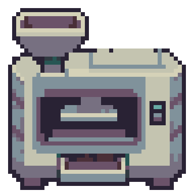

# 深空当铺像素研究
Probably Stolen机器与物品的通用提示词、GitHub建议及可复查实验。保存于2026-11-13。

**当前发现**：整数放大的真实参考，配合已知目标尺寸重建和材质色板约束，在两个样本上改善了忠实度；尚未证明通用提示词稳定优于旧版，原生直出尺寸也未通过验收。

- [通用提示词](docs/PROMPT.md)
- [研究结论与GitHub来源](docs/RESEARCH.md)
- [研究总方案](总方案.md)
- [复现步骤](docs/REPRODUCE.md)
- [首轮实际提示词](experiments/prompt-validation-20261113/prompts.json)
- [第二轮完整记录](experiments/prompt-optimization-20261113/manifest.json)

| 忠实重绘 | 小参考：主体RGB一致率 | 放大参考：主体RGB一致率 |
| --- | ---: | ---: |
| 炉子48×48 | 45.33% | 81.87% |
| 药瓶16×32 | 33.80% | 97.66% |

统计经过相同目标尺寸处理与原版色板映射，仅计算重叠主体；并非独立美感分数。每个条件仅一次，seed不可控，炉子放大组仍使用旧提示词。

## 新机器实验稿
矿粉压片机：48×48、10个主体RGB、Alpha为0/255，以下按8倍最近邻展示。未获用户视觉批准，未接入游戏。

保存六张原始生成PNG、提示词、逐方法处理结果、指标与上游固定源码。原版提取图和包含原版的对照图仅本地保存。

## GitHub依据
- [RiccardoGrin/skills](https://github.com/RiccardoGrin/skills/blob/master/skills/creating-sprites/references/prompt-guide.md)：真实参考、参考放大、结构化描述。
- [agent-sprite-forge](https://github.com/0x0funky/agent-sprite-forge/blob/main/skills/generate2dsprite/references/prompt-rules.md)：提示不是保证，网格和色板需验证。
- [Retro Diffusion MCP](https://github.com/Retro-Diffusion/retro-diffusion-mcp)：专用模型参数；未测试其服务。
- [Pixel Art Fixer](https://github.com/Retro-Diffusion/pixel-art-fixer/tree/ef376e57e1c272633ca2dbf5f29ec3fcf6596465)：实际运行的Python处理；MIT许可证随源码保存。

本研究与游戏官方无关联。自编资料未另行授予开源许可，第三方源码按附带许可证使用。独立于公司MOD发布流程。

## 此前工作合并

[机械研究、直出实验和矿化机完整索引](docs/PRIOR-WORK.md)。通用提示词已合入完整制作任务流程，默认透明；模型原稿、自动转换与原生编辑分开记录。

