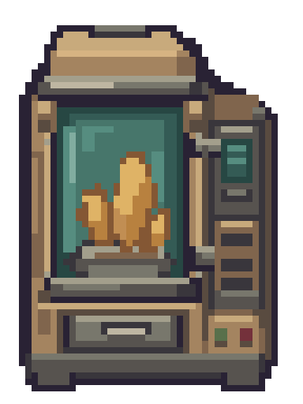

# 深空当铺像素研究

**现行默认：在目标小画布重新布局、分区域原生绘制，再减杂色和验收。** 不默认先生成高清图，不把缩小限色修边当作完整重画。

- [美术规范](docs/ART-STANDARD.md)
- [完整任务提示词](docs/PROMPT.md)
- [验收清单](docs/VALIDATION.md)
- [本轮矿化机样例](art/examples/mineral-regional/README.md)：48×64原生绘制，用户反馈比之前好，但仍有杂色；非最终视觉批准。

## 按需研究资料

[此前研究索引](docs/PRIOR-WORK.md)、[模型与转换实验](docs/RESEARCH.md)、[历史复现](docs/REPRODUCE.md)。保留失败记录与来源，旧提示词在Git历史中可追溯，不作为默认制作要求。

本研究与游戏官方无关联。自编资料未另行授予开源许可，第三方源码按附带许可证使用。原版提取素材不在本次样例中分发；本轮未接入游戏。
